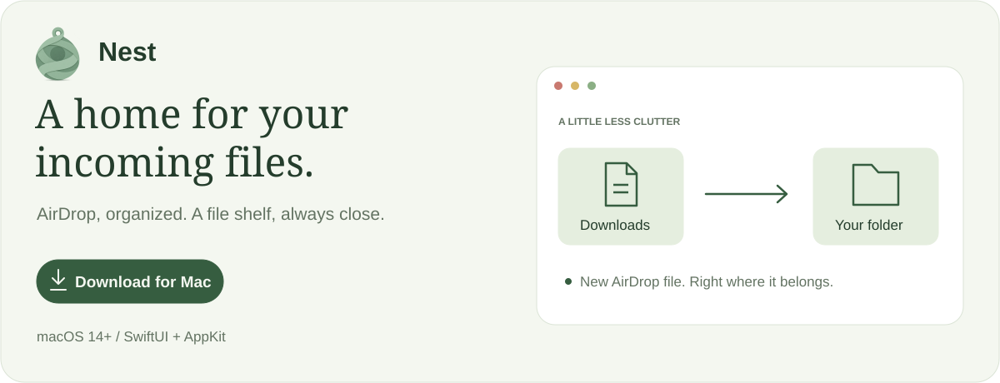

<a href="https://github.com/MohitMandalia/nest/releases/download/v0.1.0/Nest.dmg">
  <picture>
    <source media="(prefers-color-scheme: dark)" srcset="docs/assets/readme/hero-dark.svg">
    
  </picture>
</a>

 

### Get Nest

Download **[Nest.dmg](https://github.com/MohitMandalia/nest/releases/download/v0.1.0/Nest.dmg)**, open it, and drag **Nest** to **Applications**. One universal app for **Apple Silicon and Intel**, requiring **macOS 14+**.

**First launch:** Nest is self-signed and is not notarized by Apple. Open Nest once, then go to **System Settings → Privacy & Security → Open Anyway**.

Release builds are built and signed by [GitHub Actions](.github/workflows/release.yml).

Allow Downloads access and choose a destination outside Downloads. Dump keeps its files in `~/Nest Dump`.

### Support Nest

Enjoying Nest? [⭐ Star us on GitHub](https://github.com/MohitMandalia/nest) and [upvote us on Product Hunt](https://www.producthunt.com/products/nest-10). Your support helps more Mac users discover Nest.

Development &amp; how it works

Run the test suite with `swift test`.

The app is built with SwiftUI and AppKit, with no external package dependencies.

AirDrop detection uses macOS quarantine metadata on a best-effort basis. Only new files are routed after they finish arriving; existing files and received folders stay in Downloads. Duplicate filenames receive a suffix instead of overwriting existing files.

### Reporting a problem

Choose **Help → Export Diagnostics…**, or right-click Nest’s menu bar icon and choose **Export Diagnostics…**. Save the ZIP and attach it to your bug report, along with what happened, the approximate time, and steps to reproduce it. After a crash, reopen Nest before exporting; macOS may need a moment to finish writing its crash report.

Nest keeps bounded local logs in `~/Library/Logs/Nest` (up to 2 MiB total for the app and helper). Exports include these logs, app/macOS versions, and up to five available Nest crash reports from the last 14 days. Nothing is uploaded automatically. Logs omit file contents and transfer history, but errors and macOS crash reports may contain file paths or system/account details; review the ZIP before sharing. An unexpected-exit entry can also indicate a force quit or power loss.
